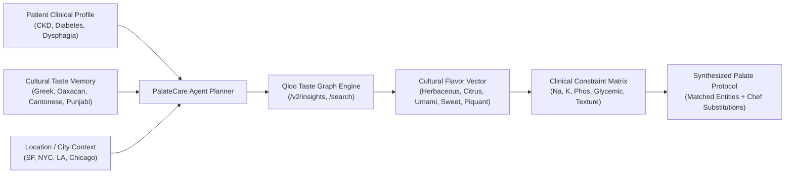

# 🌿 PalateCare AI

> **Cultural Nutrition & Clinical Taste Synthesis Agent**  
> Grounding Autonomous Health Systems in Qloo's 250M+ Entity Cultural Taste Graph


---

## 📌 Executive Summary
Patients navigating chronic conditions like **Chronic Kidney Disease (CKD)**, **Type 2 Diabetes**, **Cardiovascular Disease**, and **Oncology Dysphagia** suffer severe dietary fatigue. Standard clinical nutrition algorithms operate in a cultural vacuum—calculating strict micro-nutrient caps (e.g., Sodium <1500mg, Potassium <2000mg) and recommending generic, bland meals (boiled chicken, unseasoned vegetables).

**PalateCare AI** solves this by unifying **Qloo's Cultural Taste Graph** with deterministic clinical metabolic constraint matrices. The autonomous agent translates patients' cultural flavor memories into clinically safe dining recommendations, local restaurant selections, and customized chef adaptation guides.

---

## ⚙️ Core Architecture & Agentic Workflow



---

## 🚀 Key Features

1. **Qloo Cultural Taste Graph Grounding**:
   - Integrates with `https://hackathon.api.qloo.com/v2/insights` and `/search` using `urn:entity:place` and `urn:entity:brand` entities.
   - Computes multi-dimensional cosine similarity across 5 cultural flavor axes: *Herbaceous*, *Citrus & Acid*, *Umami*, *Sweet*, and *Piquant*.

2. **Deterministic Clinical Constraint Matrix**:
   - Gating algorithms for **CKD Stages 1–5**, **Type 2 Diabetes**, **Hypertension**, and **Oncology Dysphagia / Geriatric Dentition**.
   - Validates sodium, potassium, phosphorus, glycemic index, and physical texture compliance.

3. **Chef & Caregiver Adaptation Engine**:
   - Replaces high-sodium / high-potassium ingredients with culturally authentic flavor substitutes (e.g., substituting high-sodium feta with rinsed myzithra, lemon zest, and oregano).

4. **Tactical CLI & Live Cyberdeck Web Console**:
   - Interactive HTML5 Canvas radar chart visualizing patient flavor memory vs. Qloo synthesized matches.
   - Instant patient persona switcher and printable clinical protocol export.

---

## 🧪 Deterministic Verification Suite

The core engine contains 8 comprehensive unit tests executing in **0.000s** (sub-millisecond):

```bash
python3 -m unittest palatecare/engine/test_palatecare.py
```

```
Ran 8 tests in 0.000s
OK
```

---

## 💻 Tactical CLI Usage

```bash
# Synthesize patient dining protocol
python3 palatecare/cli/main.py plan --name "Sophia Paleologos" --cuisine "Mediterranean" --condition "CKD_Stage_3"

# Search Qloo Taste Graph entities
python3 palatecare/cli/main.py search --query "Mexican"

# Evaluate candidate food against clinical rules
python3 palatecare/cli/main.py evaluate --condition "Oncology_Dysphagia" --sodium 350 --texture "pureed_velvety"
```

---

## 🏷️ Tech Stack
- **AI & Cultural Intelligence**: Qloo API (`https://hackathon.api.qloo.com`)
- **Algorithmic Engine**: Python 3.10+ (Standard Library, Zero-Dependency)
- **Frontend & Web Console**: HTML5 Canvas, Vanilla CSS3, Modern JavaScript
- **Hosting & CI/CD**: Vercel Global Edge Network

---

## 📄 License
MIT License. See [LICENSE](LICENSE) for details.
